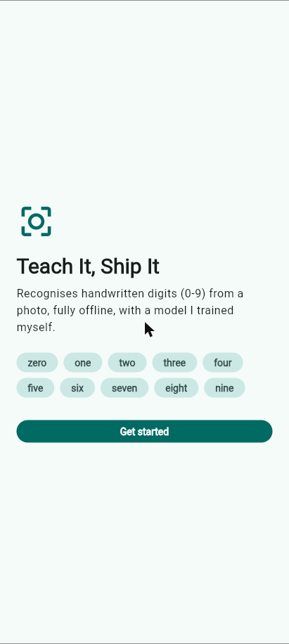
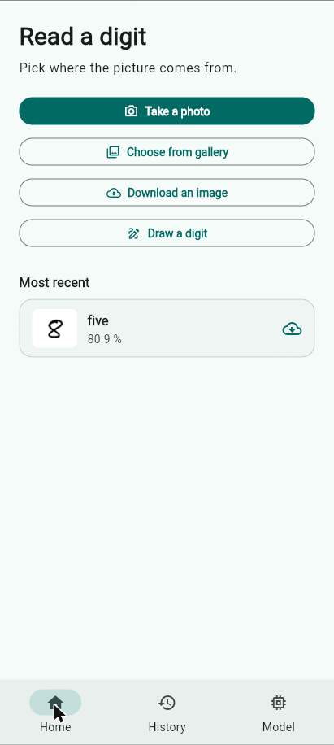
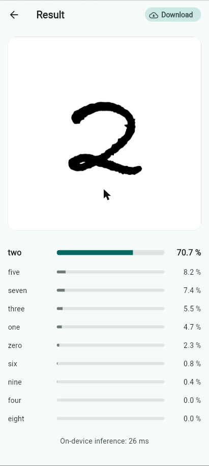
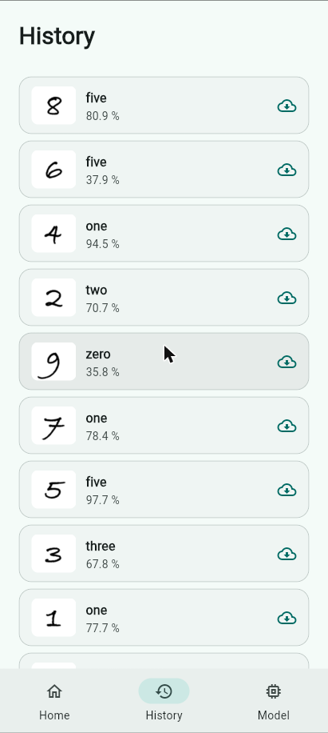
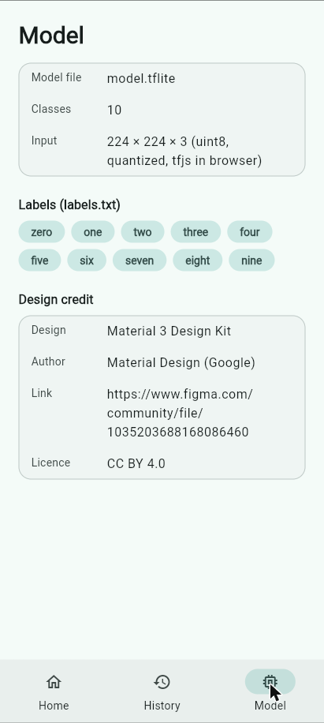

# tm_classifier

Lab 10 - image classifier with a Teachable Machine model (TFLite) in Flutter.

Take a photo, pick one from the gallery, download one from a URL or draw a digit, and it shows the percentage for each label. Everything runs on the device.

Student: Sobirjon Ismatov (240413)

## Run

The model (quantized `model.tflite`, digits 0-9) and `labels.txt` are in `assets/model/`.

1. `flutter pub get`
2. `flutter run` (Android/iOS, uses tflite_flutter)

Web: `flutter run -d chrome` (or edge). tflite_flutter needs dart:ffi, which doesn't exist on the web, so the web build runs the same model with tfjs-tflite (see `web/index.html` and `lib/services/classifier_web.dart`). On a wide window the app is shown at phone size.

Tests: `flutter test`

## Screenshots (web build)

| Welcome | Home | Result | History | Model |
|---|---|---|---|---|
|  |  |  |  |  |

Design reference frames (Material 3 Design Kit): `docs/design-1.png`, `docs/design-2.png`. Evaluation table: `NOTES.md`.
