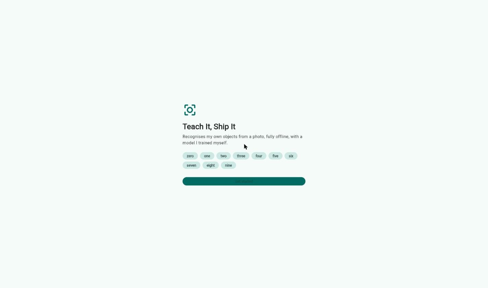
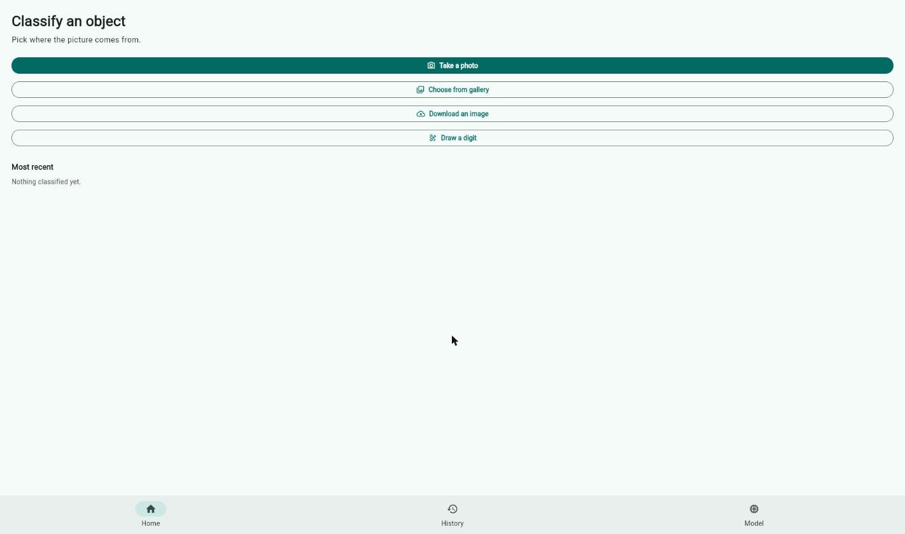
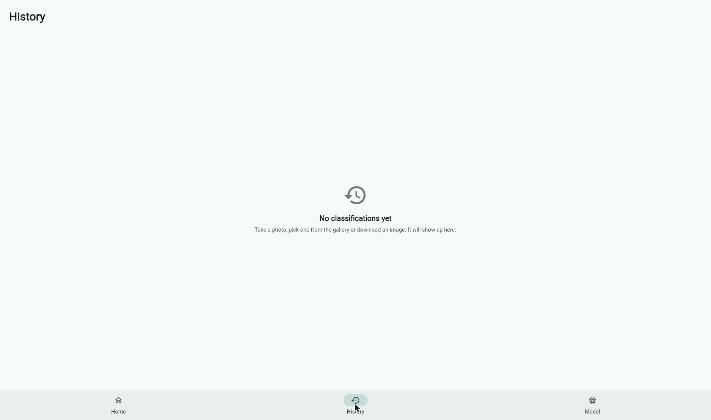
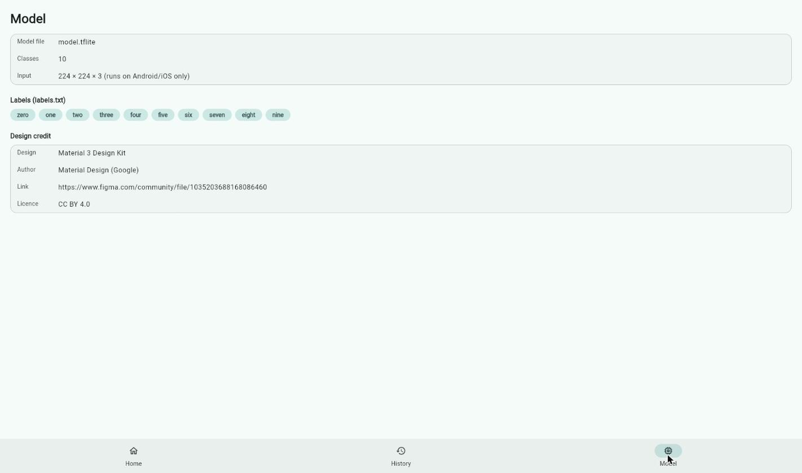

# tm_classifier

Lab 10 - image classifier with a Teachable Machine model (TFLite) in Flutter.

Take a photo, pick one from the gallery or download one from a URL and it shows the percentage for each label. Everything runs on the phone.

## Run

The model (quantized `model.tflite`, digits 0-9) and `labels.txt` are in `assets/model/`.

1. `flutter pub get`
2. `flutter run`

Tests: `flutter test`

The model runs on Android/iOS (tflite_flutter uses dart:ffi). `flutter run -d chrome` also works to look at the screens, but classifying is phone-only there.

## Screenshots (web build)

| Welcome | Home | History | Model |
|---|---|---|---|
|  |  |  |  |
